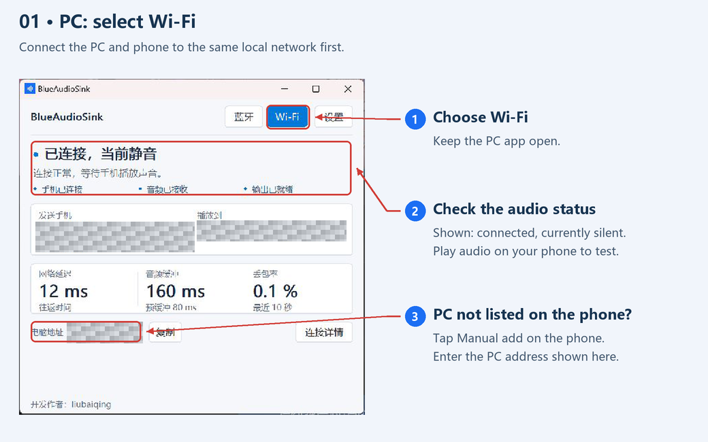
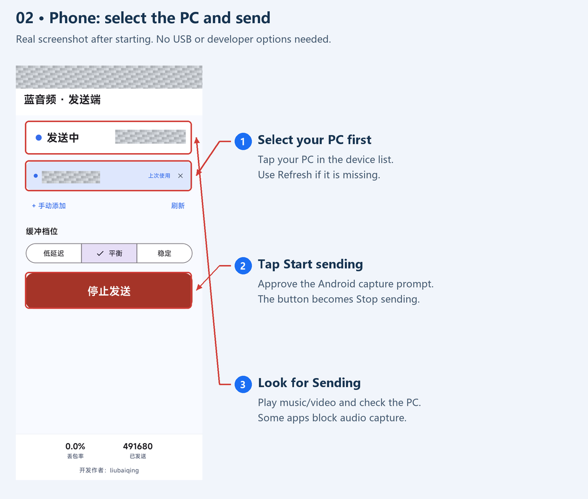
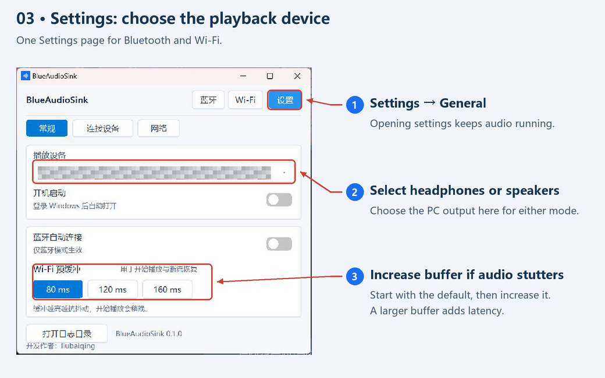
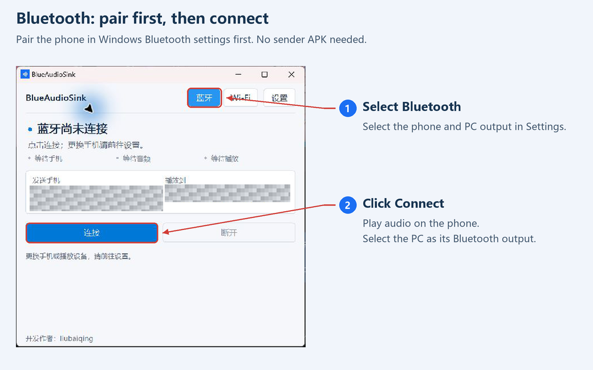
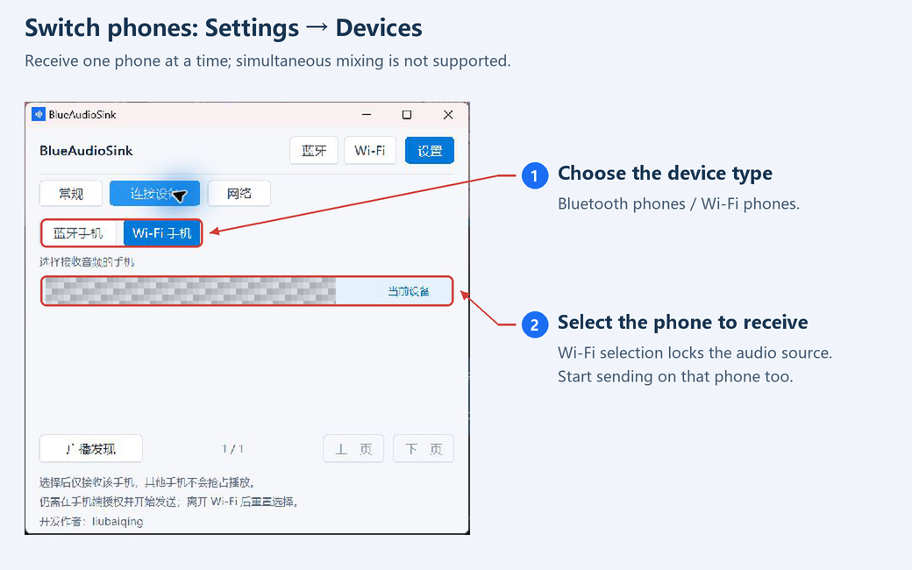
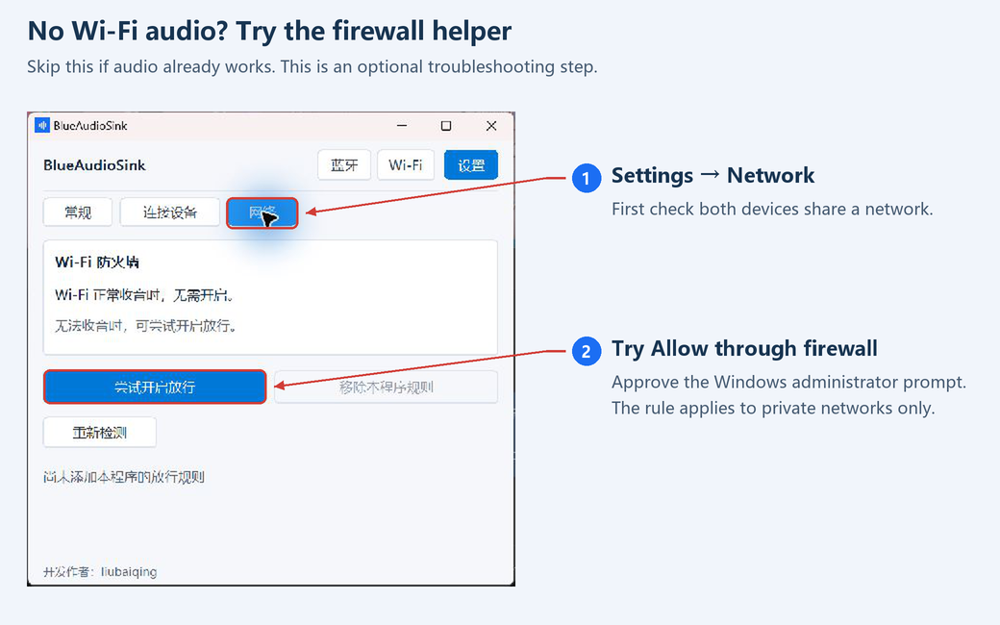

<p align="center"></p>
<h1 align="center">BlueAudioSink</h1>
<p align="center">Your phone's audio. Your PC's speakers.<br/>A lightweight Windows receiver with Bluetooth and local-network Wi-Fi modes.</p>
<p align="center"><a href="https://github.com/liubaiqing/BlueAudioSink/releases/tag/v0.1.0">Download v0.1.0</a> · English | <a href="README.zh-CN.md">简体中文</a> · <a href="LICENSE">MIT License</a></p>

Developed by **liubaiqing**. The apps currently use a Chinese interface; the guides below show which controls to use. All screenshots are from real devices. Device names, local addresses, and phone status information are masked.

## A look at both apps

| Windows receiver | Android Wi-Fi sender |
| :---: | :---: |
|  |  |

**Bluetooth** needs no Android sender. **Wi-Fi** uses the companion Android app. Both share the PC's playback and device settings.

## Download and open

| Device | Download | Requirements |
| --- | --- | --- |
| PC | [BlueAudioSink-0.1.0.exe](https://github.com/liubaiqing/BlueAudioSink/releases/download/v0.1.0/BlueAudioSink-0.1.0.exe) | Windows 10 2004+ / Windows 11, x64 |
| Phone — Wi-Fi only | [BlueAudioSink-Sender-0.1.0.apk](https://github.com/liubaiqing/BlueAudioSink/releases/download/v0.1.0/BlueAudioSink-Sender-0.1.0.apk) | Android 10+ |

Double-click the EXE; no .NET installation is needed. Open the APK on your phone and install it. Android may ask you to allow installation from the app used to open the download. The APK is a Release build signed with a dedicated key. [SHA-256 checksums](https://github.com/liubaiqing/BlueAudioSink/releases/download/v0.1.0/SHA256SUMS.txt) are available.

<details>
<summary>Already installed the old debug-signed Android APK?</summary>

Uninstall it before installing the release-signed APK. Uninstalling clears saved devices and app data. Future releases will keep the release key for in-place updates.

</details>

## Wi-Fi: three steps to listen

**First:** connect both devices to the same router. The PC can use Ethernet. **No USB, developer options, or wireless debugging is required.**

### 1. On the PC, select Wi-Fi

Keep the PC app open, then start sending from the phone.



### 2. On the phone, select the PC and start sending

Tap the PC → tap **开始发送** (Start sending) → approve Android's recording and capture prompts → play music or a video. Once started, the button becomes **停止发送** (Stop sending), as shown below.



**PC missing?** Tap **刷新** (Refresh). Still missing? Tap **手动添加** (Manual add) and enter the PC address shown in the Windows app. Keep the default port unless you changed it.

### 3. Check the PC and choose your speakers

The phone should show **发送中** (Sending). On the PC, **正在播放手机音频** means audio is playing; **已连接，当前静音** means connected but the incoming audio is silent. Play audio before judging the connection.

Open **设置 → 常规** (Settings → General) to select your headphones or speakers.



## Bluetooth: pair → select → connect

1. Pair your phone in **Windows system Bluetooth settings**.
2. In BlueAudioSink, open **设置 → 连接设备 → 蓝牙手机** and select the phone. Choose the PC output in **常规**.
3. Select **蓝牙 → 连接**. Play audio on the phone; choose the PC as its Bluetooth media output if needed.



No Android sender is needed. Adapter and driver support is required. Auto-connect attempts to connect to the preferred phone; the phone must still send audio.

## Switch phones

Open **设置 → 连接设备** (Settings → Devices), choose Bluetooth or Wi-Fi phones, then click the phone you want. A Wi-Fi phone must first select the PC in its sender app and start sending. One source plays at a time.



## No sound? Check these first

| What you see | What to do |
| --- | --- |
| Phone cannot find the PC | Keep the PC on Wi-Fi mode. Check the same router; try Refresh or Manual add. Guest networks may isolate devices. |
| Connected, currently silent | Play audio, check volumes, then try another source app. Some apps or protected content block playback capture. |
| Audio received but cannot be heard | Select the correct headphones/speakers in Settings → General. |
| Audio stutters | Prefer 5 GHz Wi-Fi. Increase buffering one step; this adds latency. |
| Wi-Fi still cannot receive | Try the optional firewall helper below. |

### Firewall helper — only if Wi-Fi reception fails

If audio works, **skip this**. Otherwise open **设置 → 网络** (Settings → Network) → **尝试开启放行**, then approve the Windows administrator prompt. This only adds rules for this EXE, private networks, and local-subnet sources. You can remove its rules on the same page.



Moving the EXE requires configuring the rule again. Public networks, organization policies, third-party firewalls, or router isolation can still block reception.

Wi-Fi audio uses unencrypted UDP; use a trusted network. Closing the PC window exits the app. Opening Settings keeps audio running. Mixing multiple phones simultaneously is not supported.

## Build from source

### Windows

Use Windows with the .NET 8 SDK or a compatible newer SDK.

```powershell
dotnet build .\BlueAudioSink.sln -c Debug -p:Platform=x64
dotnet publish .\src\SinkLite\SinkLite.csproj -c Release -p:Platform=x64
```

Output: `src/SinkLite/bin/x64/Release/net8.0-windows10.0.19041.0/win-x64/publish/BlueAudioSink.exe`.

To keep the executable small, the project uses `OutputType=Exe` and `NAudio.Wasapi`. A post-publish step uses Visual Studio's `editbin` to set the Windows subsystem and hide the console. Override the tool path for your MSVC installation:

```powershell
dotnet publish .\src\SinkLite\SinkLite.csproj -c Release -p:Platform=x64 '-p:EditBinPath=C:\path\to\editbin.exe'
```

If `editbin` is unavailable, publishing continues, but the app may open a console window.

### Android

Use JDK 21 and Android SDK 35. The repository includes the Gradle Wrapper.

```powershell
cd android
# Set ANDROID_HOME, or configure sdk.dir in your local.properties file.
.\gradlew.bat assembleDebug
```

Debug output: `android/app/build/outputs/apk/debug/app-debug.apk`.

For a signed Release build, copy `android/signing.properties.example` to `android/signing.properties`, fill in your own keystore path and credentials, then run:

```powershell
.\gradlew.bat assembleRelease
```

Signed output: `android/app/build/outputs/apk/release/app-release.apk`. Without local signing configuration, Gradle produces an unsigned Release APK. Keystores, passwords, and local SDK settings must stay out of Git. Back up your release key and credentials: subsequent app updates must use the same signing identity. Forks should use their own key.

## Validation and diagnostics

```powershell
dotnet run --project tools/AudioRegression/AudioRegression.csproj -c Release
dotnet run --project tools/FirewallRegression/FirewallRegression.csproj -c Release

.\BlueAudioSink.exe --list
.\BlueAudioSink.exe --connect
.\BlueAudioSink.exe --diagnose 30
.\BlueAudioSink.exe --help

dotnet run --project tools/SinkProbe -- endpoints
dotnet run --project tools/SinkProbe -- meter 10
```

Settings: `%LocalAppData%\BlueAudioSink\settings.ini`. Logs: `%LocalAppData%\BlueAudioSink\logs\`.

## Repository layout

- `src/SinkLite/`: Windows receiver, Win32 / GDI UI, Bluetooth, Wi-Fi, and WASAPI playback.
- `android/`: Android sender with Jetpack Compose and system playback capture.
- `tools/`: regression checks, diagnostics, and asset tools.
- `docs/`: architecture, protocol, implementation, and test records, primarily in Chinese.

See the [architecture](docs/01-architecture.md), [wire protocol](docs/02-protocol.md), [Android implementation](docs/04-android-implementation.md), [audio playback fix](docs/08-audio-playout-fix.md), and [desktop UX notes](docs/10-desktop-ux.md). Historical test results describe the devices and network conditions used at the time.

## License

[MIT](LICENSE). Third-party dependencies and tools retain their respective licenses.
