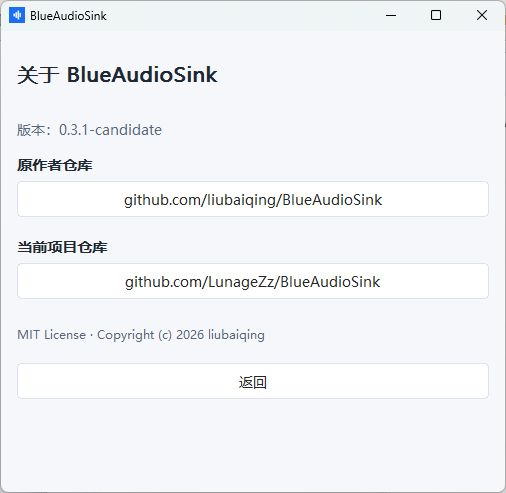
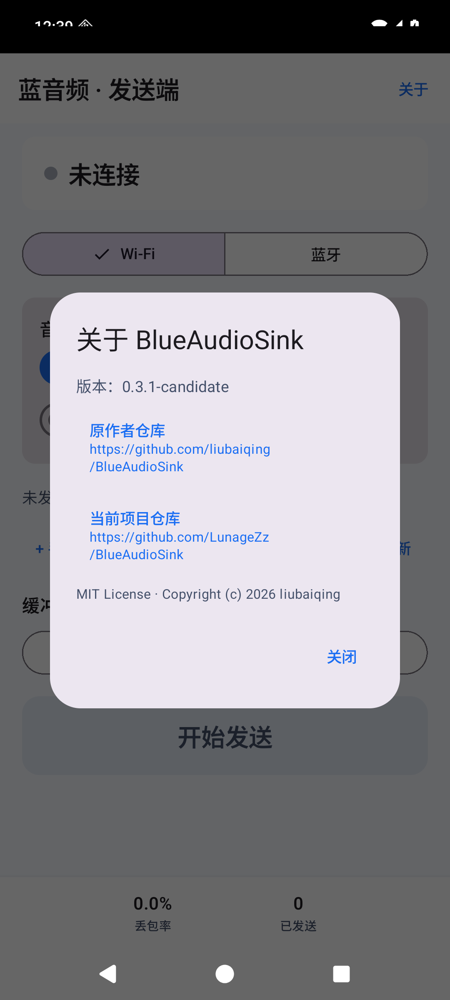
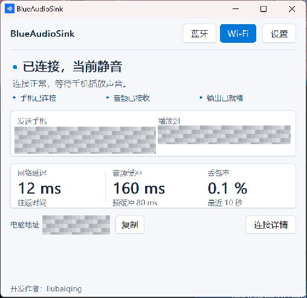
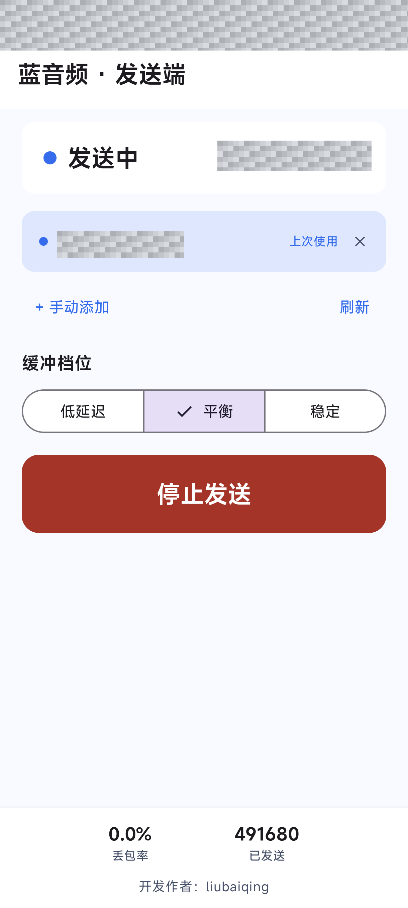

<p align="center"></p>
<h1 align="center">BlueAudioSink</h1>
<p align="center">把手机媒体声音送到电脑耳机，把手机麦克风送到电脑虚拟麦克风。</p>
<p align="center">简体中文（默认） · <a href="README.en.md">English</a> · <a href="LICENSE">MIT License</a></p>

当前正式版本：**0.3.3**，Windows 与 Android 版本一致。默认开发分支为 `main`。

## 正式版下载

| 文件 | 下载 |
| --- | --- |
| Windows x64 单文件 EXE | [BlueAudioSink-0.3.3.exe](https://github.com/LunageZz/BlueAudioSink/releases/download/v0.3.3/BlueAudioSink-0.3.3.exe) |
| Android APK | [BlueAudioSink-Sender-0.3.3.apk](https://github.com/LunageZz/BlueAudioSink/releases/download/v0.3.3/BlueAudioSink-Sender-0.3.3.apk) |
| 完整压缩包（EXE、APK、原版驱动 ZIP、许可与说明） | [BlueAudioSink-0.3.3.zip](https://github.com/LunageZz/BlueAudioSink/releases/download/v0.3.3/BlueAudioSink-0.3.3.zip) |
| 原版 VB-CABLE 驱动压缩包 | [VBCABLE_Driver_Pack45.zip](https://github.com/LunageZz/BlueAudioSink/releases/download/v0.3.3/VBCABLE_Driver_Pack45.zip) |
| SHA-256 校验值 | [SHA256SUMS.txt](https://github.com/LunageZz/BlueAudioSink/releases/download/v0.3.3/SHA256SUMS.txt) |

电脑端关闭旧程序后打开新版；EXE 自带运行时，无需安装 .NET。APK 沿用本仓库此前 Candidate 的签名，可覆盖同签名版本；与原作者或其他签名版本不兼容，不能直接覆盖安装。驱动仅在需要虚拟麦克风且尚未安装 VB-CABLE 时安装。

| 项目来源 | 仓库 |
| --- | --- |
| 原作者仓库 | [liubaiqing/BlueAudioSink](https://github.com/liubaiqing/BlueAudioSink) |
| 当前项目仓库 | [LunageZz/BlueAudioSink](https://github.com/LunageZz/BlueAudioSink) |

两端主界面底部的“开发作者”署名已移除，项目来源集中在“关于”中。原项目的 MIT 许可证与版权声明保留。

## 功能与系统要求

| 功能 | 手机端 | 电脑端 |
| --- | --- | --- |
| 蓝牙媒体播放 | 系统蓝牙媒体输出，无需发送端 App | 蓝牙模式 |
| Wi-Fi 媒体与麦克风 | 配套 Android 发送端 | Wi-Fi 模式 |
| 蓝牙麦克风 | 配套 Android 发送端，通过已配对蓝牙连接 | 蓝牙模式 |
| 会议软件使用手机麦克风 | 开启“手机麦克风” | 安装 VB-CABLE，会议软件选择 `CABLE Output` |
| 分享媒体声到虚拟麦克风 | 开启媒体来源并授予采集权限 | 开启“分享手机声音” |

电脑要求 Windows 10 2004 及以上 / Windows 11，x64；蓝牙功能需要可用适配器和驱动。手机要求 Android 10 及以上；麦克风需录音权限，蓝牙需系统对应权限。受保护内容或禁止采集的应用可能无法分享媒体声。

## 本次更新与验收范围

- Windows 增加明确的“重新连接媒体”恢复操作：主动释放并重建 A2DP 媒体连接，不主动断开应用麦克风通道。自动连接与后台重试仍保留原策略。
- 发布审查修复两项并发问题：设置统一以原子事务更新；蓝牙关闭超时后禁止新旧接收线程重叠启动。
- 蓝牙媒体继续使用系统 A2DP；手机系统媒体输出需选中电脑，应用内选电脑仅建立麦克风通道。
- 蓝牙默认只采集麦克风，不请求屏幕共享。额外开启“将媒体声加入虚拟麦克风”时才申请屏幕/音频采集授权；该开关与 Wi-Fi 媒体开关独立。
- 记住上次成功连接的蓝牙电脑：重启恢复模式，仍在配对列表中时置顶、标注并预选，不自动开始采集。
- “开始/停止发送”固定在底部，长设备列表不再把按钮挤出屏幕。
- 修复 Windows x64 蓝牙服务注册失败：`CSADDR_INFO` 对齐错误导致 SDP 注册返回 10022，手机可能提示 `read failed, socket might closed or timeout, read ret: -1`。
- 两端增加“关于”：版本、原作者仓库及当前仓库均可查看，仓库入口可点击。
- 仓库默认首页使用中文，英文保留在 [README.en.md](README.en.md)。

已完成构建与自动回归，并有麦克风可用、A2DP 媒体经完整重连后恢复的现场反馈。仍未覆盖所有蓝牙适配器、手机与会议软件的长期并行验收；底层偶发媒体无声的原因未完全确认，保留手动恢复入口。详见 [正式发布记录](docs/17-release-0.3.3.md)。

## 使用方法

### Wi-Fi 媒体与麦克风

1. 两端连接同一局域网，电脑可以使用网线，无需 USB 或开发者选项。
2. 电脑打开 BlueAudioSink，选择“Wi-Fi”。手机选择“Wi-Fi”，点击发现的电脑；找不到时刷新或手动输入电脑显示的地址。
3. 手机选择媒体、麦克风来源，点击“开始发送”，按系统提示授权。
4. 电脑在“设置 → 常规”选择耳机或音箱；在“设置 → 麦克风”配置虚拟麦克风。

接收正常时无需修改防火墙。若 Wi-Fi 无法接收，可使用“设置 → 网络”的放行工具，再检查路由器设备隔离。

### 蓝牙媒体播放

1. 在 Windows 和手机系统蓝牙设置中完成配对。
2. 电脑选择“蓝牙”，在“设置 → 连接设备”选择手机并连接。
3. 手机播放媒体，并在系统中选择电脑作为蓝牙媒体输出。

如果手机确实在播放、系统输出也已选择电脑，但仍无声，请在电脑端点击“重新连接媒体”。已现场验证完整断开并重建 A2DP 后媒体声音恢复；新按钮执行相同的媒体恢复流程。无声也可能只是手机暂停播放，因此程序不会定时强制重连。

### 蓝牙麦克风

1. 两端使用本分支对应版本，在系统设置中配对，电脑选择“蓝牙”。
2. 确认电脑显示“等待手机蓝牙麦克风连接”；若显示“不可用”，先查看日志。
3. 手机发送端选择“蓝牙”，选择已配对电脑，默认开启“手机麦克风”，点击底部“开始发送”。默认不采集媒体，不需要屏幕共享。
4. 电脑安装或选择 VB-CABLE。BlueAudioSink 向 `CABLE Input` 写入声音，会议或录音软件选择 `CABLE Output` 为输入。

系统媒体连接与应用麦克风通道独立，媒体能播放不代表麦克风服务已就绪。完整说明见 [蓝牙麦克风使用与待验收项目](docs/13-bluetooth-microphone.md)。

听音乐时需在手机的**系统媒体输出**中选择电脑（例如 LUNAGE），无需在本应用开启发送。如果还希望把音乐混入会议麦克风，可额外开启“将媒体声加入虚拟麦克风”，确认系统屏幕/音频采集授权，并在电脑开启“分享手机声音”。

### 关于

Windows 点击右下角“关于”，点击仓库按钮可打开默认浏览器；点击“返回”或按 Esc 回到原页面。Android 点击标题栏右侧“关于”，关闭弹窗返回。打开关于不会主动断开音频连接。

| Windows 关于 | Android 关于 |
| :---: | :---: |
|  |  |

关于截图来自 0.3.1 Candidate，0.3.2 保留相同入口与仓库信息，版本号随新包更新。

## 界面参考

下图是旧版实机截图，仅说明主要操作位置；本次关于入口与蓝牙麦克风功能以当前程序及说明为准。

| Windows 接收端 | Android 发送端 |
| :---: | :---: |
|  |  |

## 获取与构建

当前代码见 [main 分支](https://github.com/LunageZz/BlueAudioSink/tree/main)，可复现发布源码见 [v0.3.3 标签](https://github.com/LunageZz/BlueAudioSink/tree/v0.3.3)。旧 Candidate 文档作为开发记录保留，正式包以 [v0.3.3 Release](https://github.com/LunageZz/BlueAudioSink/releases/tag/v0.3.3) 为准。

### Windows

需要 .NET 8 SDK、Windows 目标包及 NuGet 网络访问。发布为自带运行时的 x64 单文件：

Windows 发布时优先使用 MSVC `editbin` 设置 GUI 子系统；未安装 Visual Studio 时会自动使用仓库自带 PowerShell 脚本处理，双击运行无需控制台窗口。

```powershell
# 构建可直接运行的 Windows 接收端。
dotnet publish src/SinkLite/SinkLite.csproj -c Release -r win-x64 -o artifacts/windows

# 验证音频处理；蓝牙硬件检查需要 Windows 蓝牙适配器。
dotnet run --project tools/AudioRegression/AudioRegression.csproj -c Release
pwsh -NoProfile -File tools/Test-RfcommListener.ps1 -Hardware
```

### Android

需要 JDK 17 或 21、Android SDK Platform 35、对应构建工具及可用网络。Gradle Wrapper 使用 8.11.1。

```powershell
# 编译发送端并执行单元测试与 lint。
cd android
.\gradlew.bat assembleDebug testDebugUnitTest lintDebug
```

Release 使用本地 `android/signing.properties` 和自己的密钥，格式见 [签名配置示例](android/signing.properties.example)。密钥和密码不入库、不随安装包分发。不同签名的 APK 无法直接覆盖安装，需使用与已安装版本一致的密钥。

```powershell
# 配好本地签名后生成 Release APK。
.\gradlew.bat assembleRelease
```

临时下载、诊断和安装包统一放在 `artifacts/`，可整体删除，不影响源码。

## 开发文档

- [Android 实现](docs/04-android-implementation.md)
- [测试与验收](docs/05-testing-acceptance.md)
- [桌面交互规范](docs/10-desktop-ux.md)
- [蓝牙麦克风协议与验收](docs/13-bluetooth-microphone.md)
- [0.3.1 Candidate 构建与验收记录](docs/14-release-0.3.1-candidate.md)
- [0.3.2 Candidate 行为与验证记录](docs/15-bluetooth-capture-and-memory.md)
- [Windows 0.3.3 A2DP 手动恢复说明](docs/16-a2dp-media-reconnect.md)
- [0.3.3 正式发布、审查与验证记录](docs/17-release-0.3.3.md)

## 开源许可

[MIT License](LICENSE)。保留原项目版权声明，两个客户端的“关于”均提供原仓库与当前仓库入口。

普通 VB-CABLE 驱动以原包原样分发，属于 VB-Audio 的 Donationware，欢迎支持原作者，不适用本项目 MIT 许可。详见 [第三方软件说明](THIRD_PARTY_NOTICES.md)。
