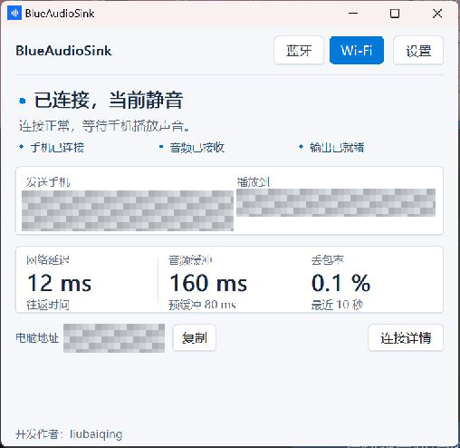
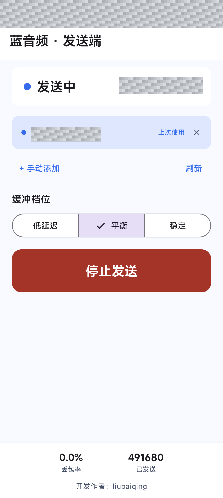
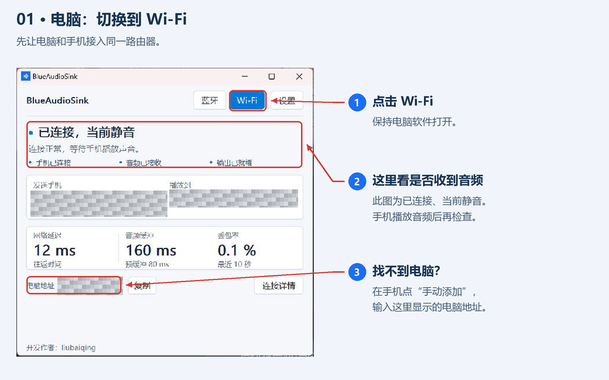
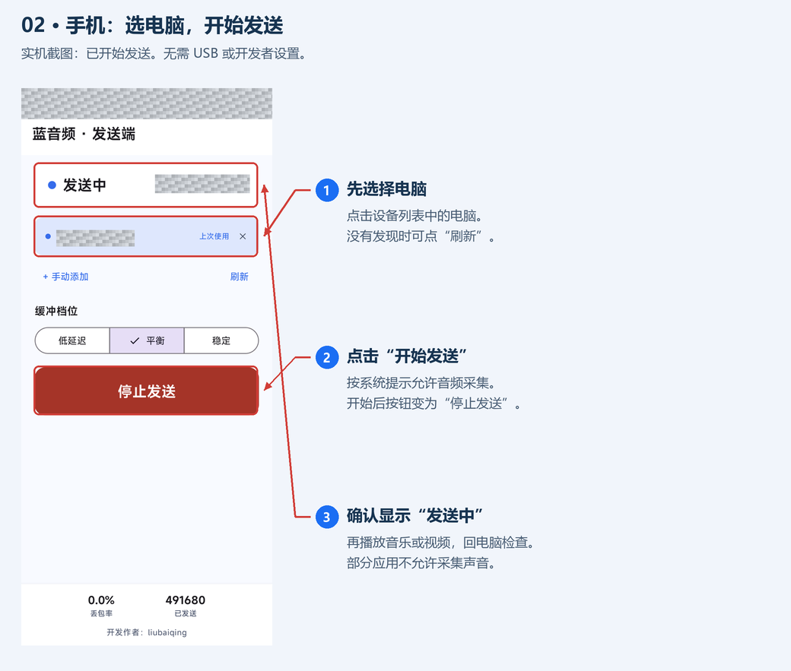
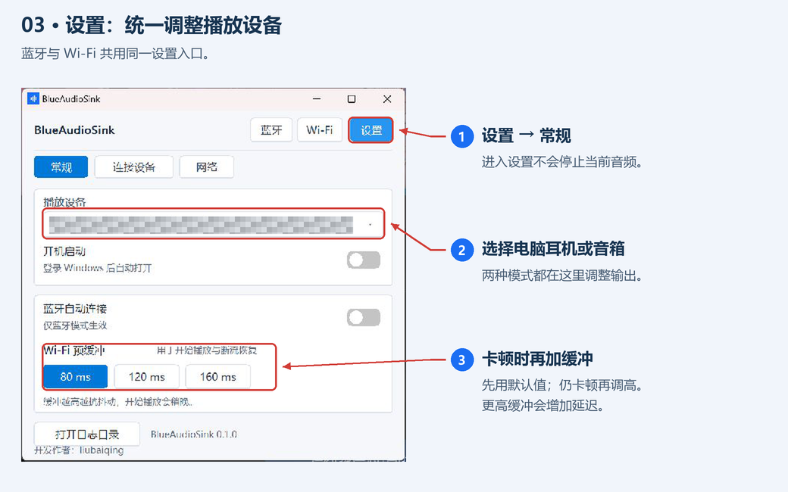
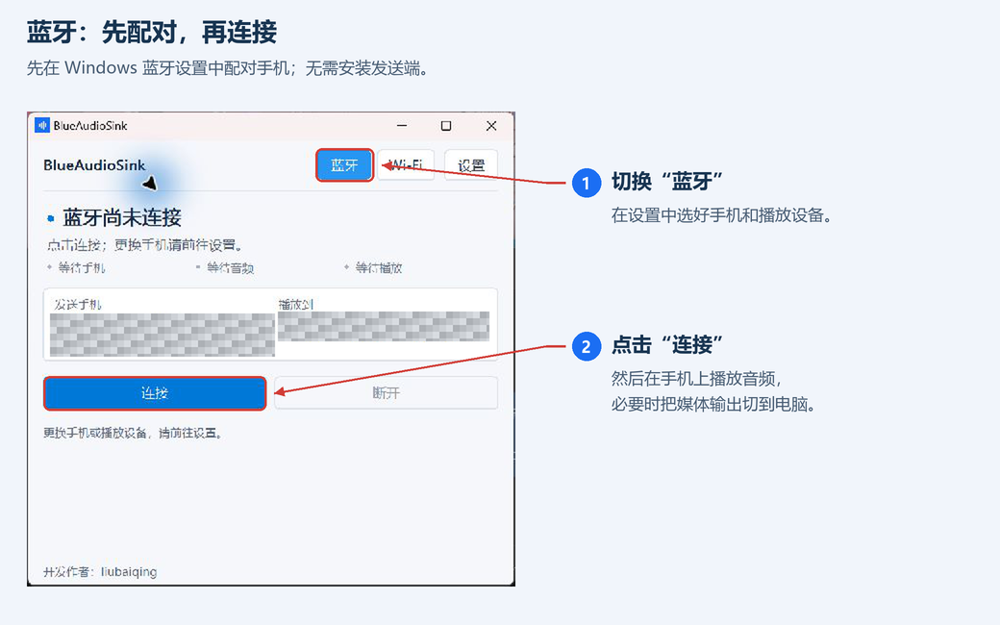
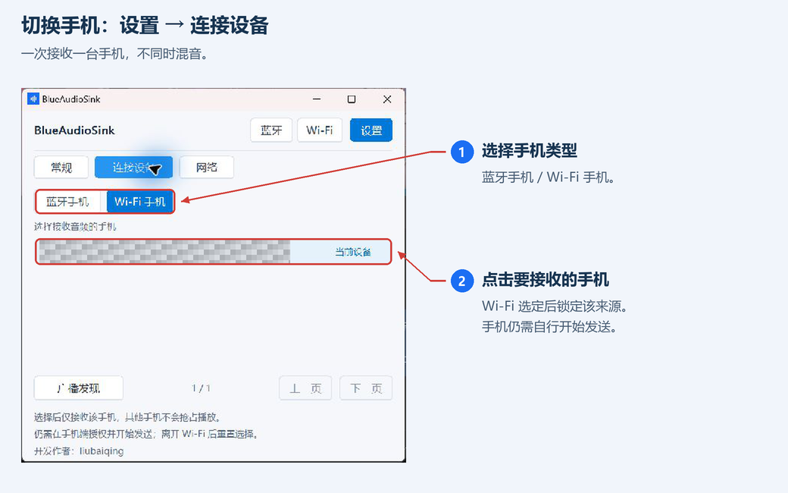
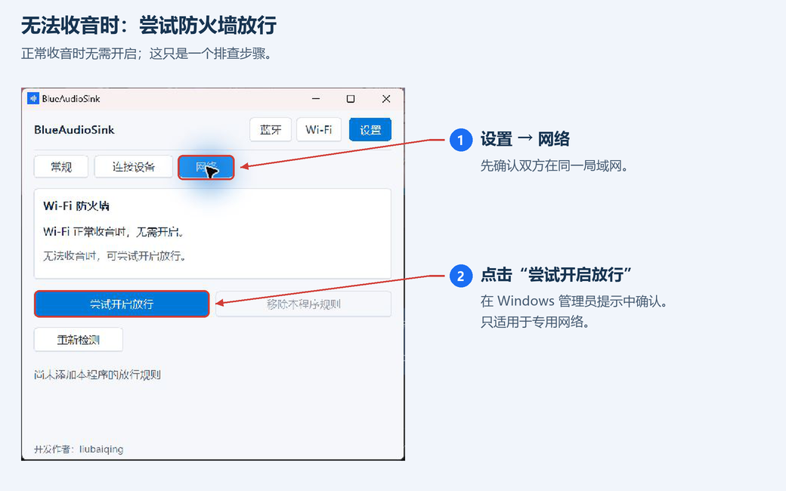

<p align="center"></p>
<h1 align="center">BlueAudioSink</h1>
<p align="center">手机的声音，用电脑的耳机或音箱播放。<br/>轻量 Windows 接收端，支持蓝牙与局域网 Wi-Fi。</p>
<p align="center"><a href="https://github.com/liubaiqing/BlueAudioSink/releases/tag/v0.1.0">下载 v0.1.0</a> · <a href="README.md">English</a> | 简体中文 · <a href="LICENSE">MIT 开源</a></p>

开发作者：**liubaiqing**。以下均为双端实机截图，设备名称、局域网地址和手机状态信息已遮挡。

## 双端界面

| 电脑接收端 | Android Wi-Fi 发送端 |
| :---: | :---: |
|  |  |

**蓝牙模式**无需安装手机 App；**Wi-Fi 模式**搭配 Android 发送端使用。两种模式共用电脑端设置。

## 下载并打开

| 设备 | 下载 | 系统要求 |
| --- | --- | --- |
| 电脑 | [BlueAudioSink-0.1.0.exe](https://github.com/liubaiqing/BlueAudioSink/releases/download/v0.1.0/BlueAudioSink-0.1.0.exe) | Windows 10 2004+ / Windows 11，x64 |
| 手机（仅 Wi-Fi 需要） | [BlueAudioSink-Sender-0.1.0.apk](https://github.com/liubaiqing/BlueAudioSink/releases/download/v0.1.0/BlueAudioSink-Sender-0.1.0.apk) | Android 10 及以上 |

电脑双击 EXE 即可，无需安装 .NET。手机打开 APK 安装；若系统询问，允许当前打开文件的应用安装 APK。手机包为独立发布密钥签名的 Release 版本。[文件校验值](https://github.com/liubaiqing/BlueAudioSink/releases/download/v0.1.0/SHA256SUMS.txt)随发布提供。

<details>
<summary>安装过旧测试签名版？点这里</summary>

先卸载旧版，再安装正式签名版。卸载会清除已保存设备和应用数据；后续正式版使用同一密钥，支持覆盖升级。

</details>

## Wi-Fi：照着做，三步开始

**准备：**手机和电脑接入同一路由器，电脑也可以插网线。**无需 USB、开发者模式或无线调试。**

### 1. 电脑点击「Wi-Fi」

保持电脑软件打开，接下来到手机上开始发送。



### 2. 手机选电脑，点击「开始发送」

点设备列表中的电脑 → 点「开始发送」→ 按 Android 提示允许录音与音频采集 → 播放音乐或视频。开始后，同一个按钮会变为「停止发送」，如下图。



**找不到电脑？**先点「刷新」。仍找不到就点「手动添加」，输入电脑界面显示的地址；没有改过端口就保持默认。

### 3. 看电脑状态，选好播放设备

手机显示「发送中」后，电脑显示「正在播放手机音频」表示正在出声；「已连接，当前静音」表示已连通，但收到的音频是静音。请先在手机播放声音再判断。

打开「设置 → 常规」，选择要使用的电脑耳机或音箱。



## 蓝牙：先配对，再选手机，最后连接

1. 先到 **Windows 系统蓝牙设置**配对手机。
2. 在本软件「设置 → 连接设备 → 蓝牙手机」选手机，在「常规」选电脑播放设备。
3. 顶部点「蓝牙 → 连接」，再用手机播放音频；必要时把手机的蓝牙媒体输出切到电脑。



蓝牙模式无需手机发送端，需电脑适配器与驱动支持。自动连接负责尝试连接首选手机，手机仍需实际发送音频。

## 多台手机怎么切换？

进入「设置 → 连接设备」，选择「蓝牙手机 / Wi-Fi 手机」，再点要接收的手机。Wi-Fi 手机需先在发送端选择这台电脑，并自行开始发送。一次播放一台手机。



## 没声音？按现象检查

| 遇到的情况 | 怎么做 |
| --- | --- |
| 手机找不到电脑 | 电脑停在 Wi-Fi 页，确认同一路由器；尝试刷新或手动添加。访客网络可能隔离设备。 |
| 已连接，当前静音 | 先在手机播放声音、检查音量，再换一个播放应用；部分应用或受保护内容不允许采集。 |
| 电脑收到音频但听不到 | 到「设置 → 常规」选择正确的耳机或音箱。 |
| 声音卡顿 | 优先用 5 GHz Wi-Fi，再把缓冲调高一档；缓冲越高，延迟也越高。 |
| Wi-Fi 一直无法收音 | 尝试下面的防火墙辅助功能。 |

### 防火墙放行：正常收音就跳过

只有无法收音时，再进入「设置 → 网络 → 尝试开启放行」，并在 Windows 管理员提示中确认。它只为当前程序添加专用网络、局域网来源的规则；可在同页移除。



移动 EXE 后需重新配置。公共网络、组织策略、第三方防火墙或路由器隔离仍可能影响收音。

Wi-Fi 音频使用未加密 UDP，请在可信局域网使用。关闭电脑窗口即退出；进入设置不会停止当前音频。不支持多手机同时混音。

## 从源码构建

### Windows

需要 .NET 8 SDK 或兼容的新版本 SDK，以及 Windows 开发环境。

```powershell
dotnet build .\BlueAudioSink.sln -c Debug -p:Platform=x64
dotnet publish .\src\SinkLite\SinkLite.csproj -c Release -p:Platform=x64
```

产物位于 `src/SinkLite/bin/x64/Release/net8.0-windows10.0.19041.0/win-x64/publish/BlueAudioSink.exe`。

为保持单文件体积，项目使用 `OutputType=Exe` 和 `NAudio.Wasapi`。发布后通过 Visual Studio 的 `editbin` 设置 Windows 子系统以隐藏控制台；请按本机 MSVC 安装位置传入路径：

```powershell
dotnet publish .\src\SinkLite\SinkLite.csproj -c Release -p:Platform=x64 '-p:EditBinPath=C:\path\to\editbin.exe'
```

若找不到 `editbin`，构建仍会继续，但启动时可能出现控制台窗口。

### Android

需要 JDK 21、Android SDK 35。仓库提供 Gradle Wrapper。

```powershell
cd android
# 配置 ANDROID_HOME，或在未入库的 local.properties 中填写 sdk.dir
.\gradlew.bat assembleDebug
```

测试 APK 位于 `android/app/build/outputs/apk/debug/app-debug.apk`。正式签名构建：复制 android/signing.properties.example 为 android/signing.properties，填写自己的密钥路径和密码，再运行 .\gradlew.bat assembleRelease。没有签名配置时仅生成未签名的 Release APK。不要提交密钥、密码或本机 SDK 配置；后续更新必须保留并继续使用同一发布密钥。

## 验证与诊断

```powershell
dotnet run --project tools/AudioRegression/AudioRegression.csproj -c Release
dotnet run --project tools/FirewallRegression/FirewallRegression.csproj -c Release

.\BlueAudioSink.exe --list
.\BlueAudioSink.exe --connect
.\BlueAudioSink.exe --diagnose 30
.\BlueAudioSink.exe --help

dotnet run --project tools/SinkProbe -- endpoints
dotnet run --project tools/SinkProbe -- meter 10
```

配置保存在 `%LocalAppData%\BlueAudioSink\settings.ini`，日志位于 `%LocalAppData%\BlueAudioSink\logs\`。

## 项目结构

- `src/SinkLite/`：Windows 客户端，Win32 / GDI 界面、蓝牙连接、Wi-Fi 接收和 WASAPI 播放。
- `android/`：Android 发送端，Jetpack Compose 界面与系统播放音频采集。
- `tools/`：音频、防火墙回归验证及诊断工具。
- `docs/`：架构、协议、实现与测试记录。

进一步阅读：[架构](docs/01-architecture.md)、[协议](docs/02-protocol.md)、[Android 实现](docs/04-android-implementation.md)、[音频播放修复](docs/08-audio-playout-fix.md)、[桌面交互](docs/10-desktop-ux.md)。文档中的实测记录对应当时的设备与网络条件。

## 许可证

[MIT](LICENSE)。第三方依赖及工具保留各自的许可证。
